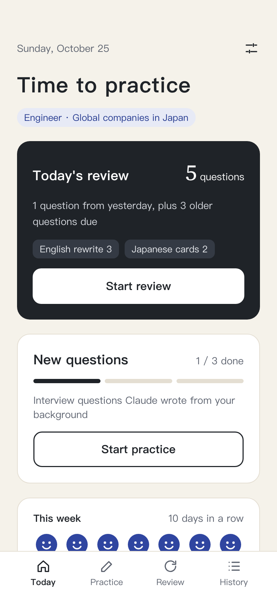
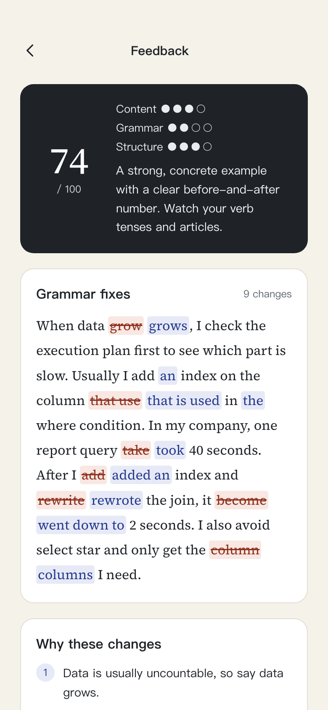
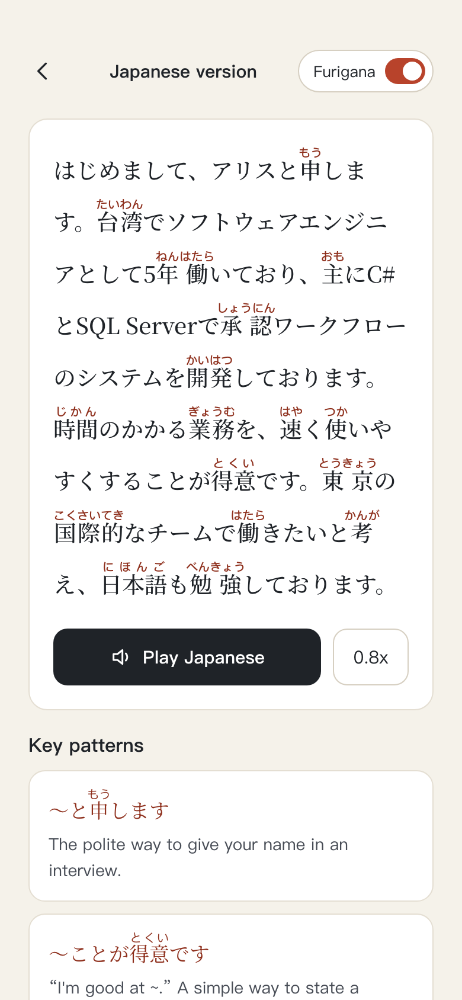
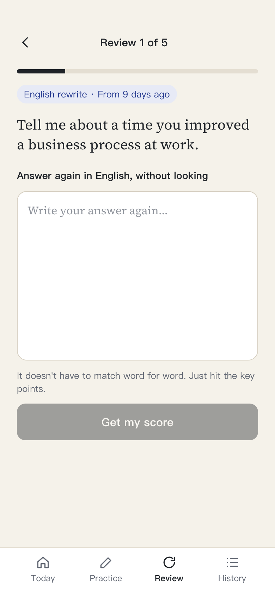
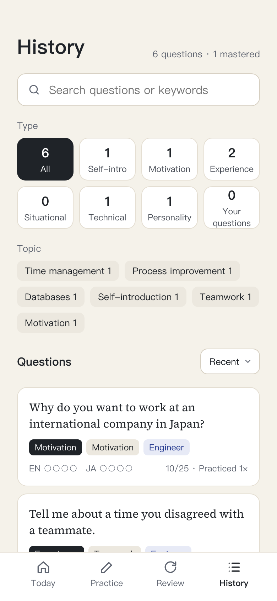

# Kotae（答え）

**An AI interview practice app for English and Japanese.** I built it to prepare for engineering interviews at international companies in Japan. Every day Claude writes interview questions from my background, corrects my English answers, and turns them into natural interview Japanese with furigana. Spaced repetition makes sure I can still say them weeks later.

**Live:** https://kotae-tawny.vercel.app — tap **Try the demo** on the sign-in page to explore with sample data (no sign-in, and nothing is sent to Claude). There's also an [About page](https://kotae-tawny.vercel.app/about).

| Today | Feedback | Japanese | Review | History |
| --- | --- | --- | --- | --- |
|  |  |  |  |  |

## The daily loop

1. **Answer.** Claude writes new questions each day from my background (self-intro, STAR experience questions, technical questions and more). I answer in English, by typing or with Apple Pencil on iPad.
2. **Feedback.** A score out of 100, every grammar fix marked in the text with the reason, what the interviewer is really asking (covered / could add, plus useful keywords), and a polished answer that's easy to say out loud. I can ask follow-up questions in a chat.
3. **Japanese.** The polished answer turned into natural interview Japanese (です・ます and humble forms), with furigana on every kanji, read-aloud at 0.8x or 1x, and key patterns to memorize. Readings can be fixed by hand.
4. **Review.** Spaced repetition at 1, 3, 7, 14 and 30 days, scheduled separately for English and Japanese. I rewrite the English answer from memory and Claude scores whether I hit the key points; Japanese uses flashcards. A daily cap keeps reviews manageable.

## How Claude is used

- **The right model for each job.** Sonnet writes questions, feedback and translations; Haiku scores reviews, which is faster and cheaper.
- **Structured output.** Every call returns JSON that matches a schema, so the UI can render grammar diffs, scores and furigana reliably. The app also checks that the grammar fixes rebuild the original answer.
- **Prompt caching.** The long, fixed instructions are cached; only the question and answer change between calls.
- **Tuned for speaking.** Prompts ask for short, common words that are easy to say. Capitalization and punctuation are ignored, because these answers are spoken, not written.
- **Follows the UI language.** The prompts are written in Chinese for me; when the interface is in English, an extra line asks Claude to write its explanations in English.
- **Cost tracking.** Every call is logged with its tokens and estimated cost, and Settings shows today, this month and all time.

## Demo mode

Visitors can explore without the password. The demo uses a separate PostgreSQL schema (`demo`) with the same tables and English sample data, dated relative to today. Data access goes through `getDb()`, which picks the demo schema for demo sessions, so visitors never see or change real data. In the demo, Claude is never called: the places that would ask Claude show prepared sample content instead, with a note saying so. The sample data is rebuilt when it's from another day or more than 30 minutes old.

## Tech

Next.js 16 (App Router, Server Actions) · React 19 · TypeScript · Prisma 7 · PostgreSQL (Neon) · Claude API · Web Speech API · PWA · Vercel

- No UI library or Tailwind: CSS Modules with CSS variables for two color themes.
- Chinese and English UI with a small dictionary (`app/i18n/`), no extra packages.
- Single-password sign-in (scrypt hash, HMAC-signed cookie), with "remember this device for 30 days".

```
app/
  page.tsx, practice/, review/, history/, settings/, login/, about/   pages
  components/      shared UI (bottom nav, bottom sheet, speak button, furigana)
  i18n/            zh.tsx / en.tsx dictionaries, getT() (server), useT() (client)
  lib/
    ai.ts          calls Claude: models, caching, usage logging, errors
    *-data.ts      prompts and JSON schemas for each feature
    *-store.ts     database access (Prisma)
    db.ts          getDb(): real data or the demo schema
    demo-*.ts      demo session, sample data, sample AI content
prisma/            schema and migrations
scripts/           password setup, icons, migrations for production and the demo schema
docs/              spec and screen designs
```

## Running locally

Requires Node.js 24 and PostgreSQL (I use Docker).

```bash
npm install
# .env.local: DATABASE_URL, ANTHROPIC_API_KEY, and KOTAE_AI_LIVE=1 to really call Claude
node scripts/set-password.mjs        # sets the sign-in password and session secret
npx prisma migrate deploy            # tables for your data
node scripts/migrate-demo.mjs        # tables for the demo schema
npm run dev
```

Without `KOTAE_AI_LIVE=1`, the app uses fixed sample content instead of calling Claude, so it costs nothing to try.

## How it was made

I wrote the spec and designed all 9 screens in two color themes first, then built the app in about 2.5 weeks with [Claude Code](https://claude.com/claude-code), while learning Next.js and TypeScript for the first time. Midway through, the database moved from SQL Server to PostgreSQL and all the practice data was migrated.
